# Advanced QR Code Generator

A responsive Flask web application for creating, customizing, downloading and organizing QR codes. QR codes are generated on the server by the Flask app (Python `qrcode` + Pillow); your saved library and preferences are stored **in your own browser** using `localStorage`. There is no database, no account system and no external API.

**Developed and designed by Ratnesh Pathak**
Repository: <https://github.com/RatneshPathak/QR-Code-Generator>

---

## Features

- **Nine content types:** plain text, website URL, email, phone, SMS, Wi-Fi, vCard contact, WhatsApp chat link, map location
- **Server-side validation** with clear error messages for every type
- **Live preview** with a loading state; style changes re-render automatically once a code exists
- **Customization studio:** foreground/background colors, size (256-1024 px), error-correction level (L/M/Q/H), optional logo overlay, reset button, random color presets
- **Contrast checking** (WCAG contrast ratio) with warnings for low-contrast, inverted colors and logo overlays
- Adding a logo automatically raises error correction to H and updates the selected setting. A scan-safety reminder remains because logos cover part of the code.
- **Export:** PNG and SVG. Downloads are rendered by the server from the current settings
- **Saved library:** save, search, reopen, download and delete entries; clear everything after confirmation
- **Extras:** copy QR content, character counter, generated/saved statistics, light/dark theme, toast notifications, keyboard-accessible controls with visible focus states, mobile-friendly layout

## Technology stack

| Layer | Technology |
|---|---|
| Backend | Python 3, Flask |
| QR generation | `qrcode`, Pillow |
| Frontend | HTML5, CSS3, vanilla JavaScript (inline SVG icons, no CDN) |
| Persistence | Browser `localStorage` |
| Tests | Python `unittest` |


## 🖥️ Screenshots

Explore the Advanced QR Code Generator interface, including its light and dark themes, QR generation forms, and saved QR library.

### 🎨 Dashboard Themes

<table>
  <tr>
    <th>Light Theme</th>
    <th>Dark Theme</th>
  </tr>
  <tr>
    <td>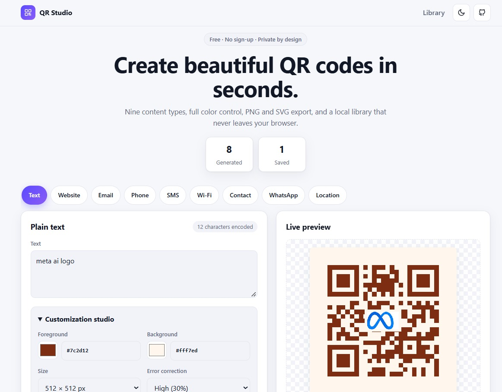</td>
    <td>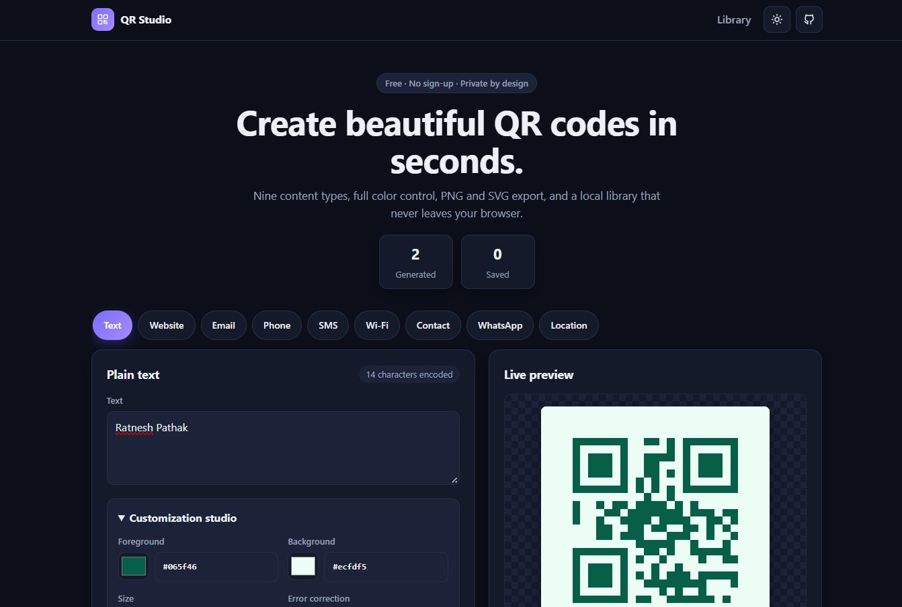</td>
  </tr>
</table>

### 📱 QR Code Generation

<table>
  <tr>
    <th>Text QR</th>
    <th>Website QR</th>
  </tr>
  <tr>
    <td>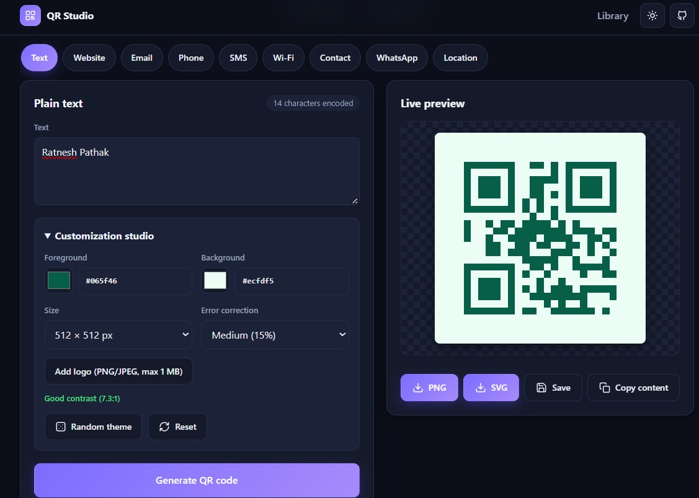</td>
    <td>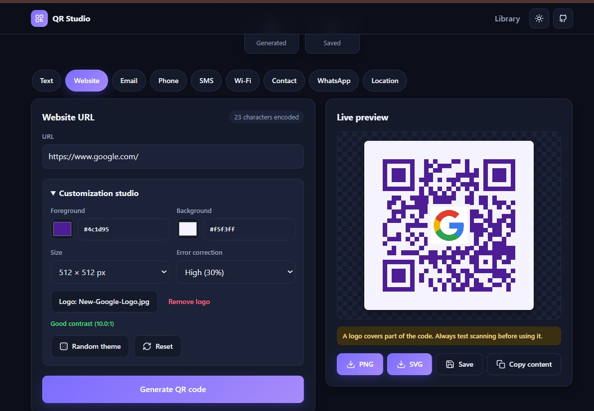</td>
  </tr>
  <tr>
    <th>Contact QR</th>
    <th>Email QR</th>
  </tr>
  <tr>
    <td>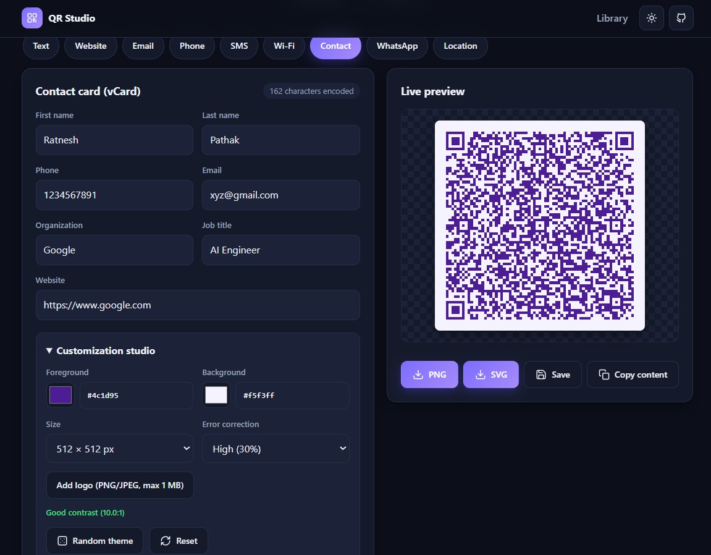</td>
    <td>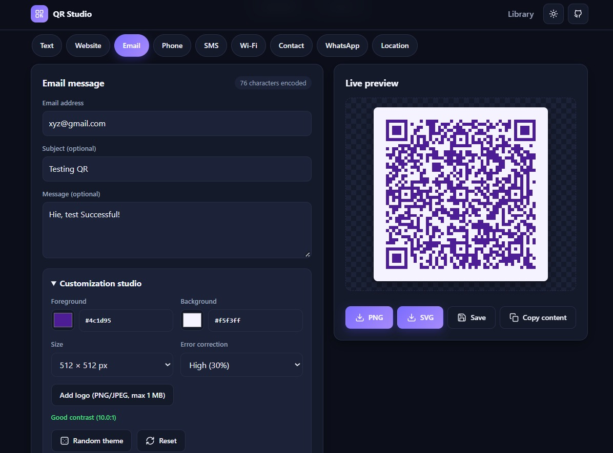</td>
  </tr>
  <tr>
    <th>Phone QR</th>
    <th>SMS QR</th>
  </tr>
  <tr>
    <td>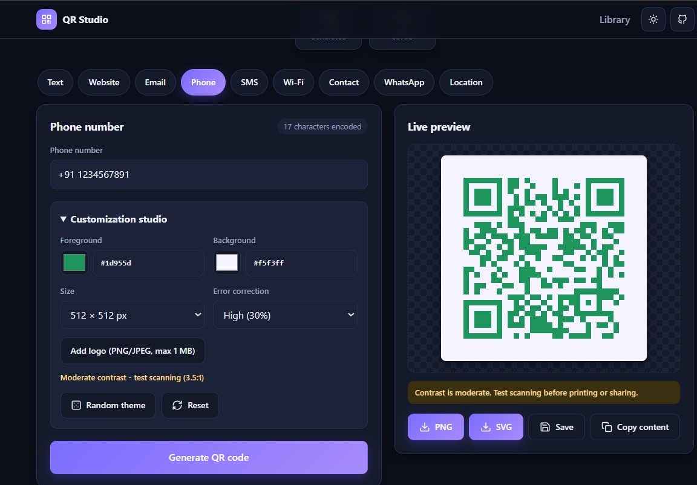</td>
    <td>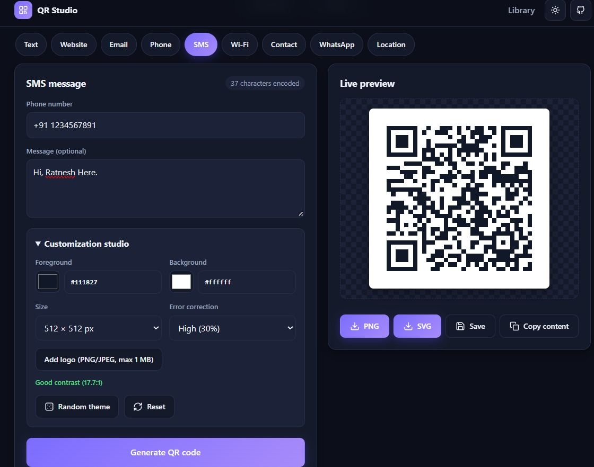</td>
  </tr>
  <tr>
    <th>Location QR</th>
    <th>Wi-Fi QR</th>
  </tr>
  <tr>
    <td>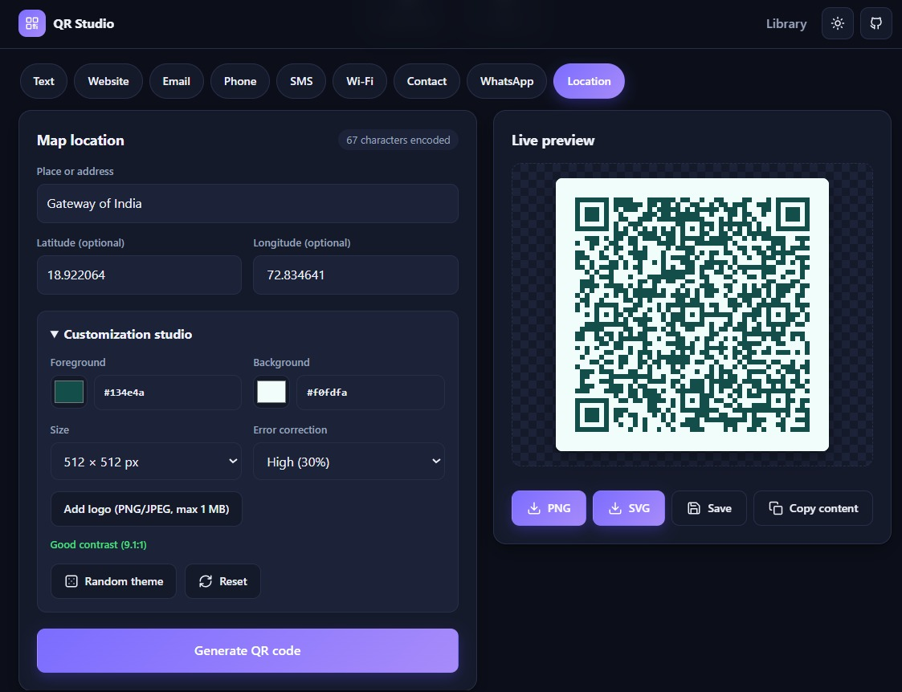</td>
    <td>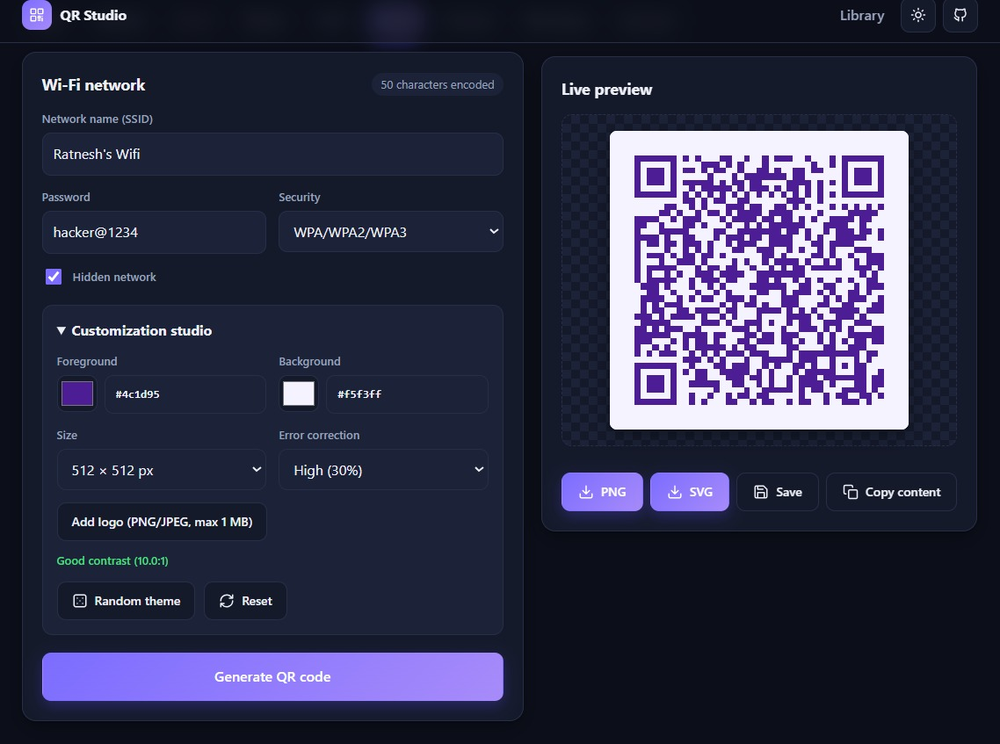</td>
  </tr>
  <tr>
    <th>WhatsApp QR</th>
    <th>Saved QR Library</th>
  </tr>
  <tr>
    <td>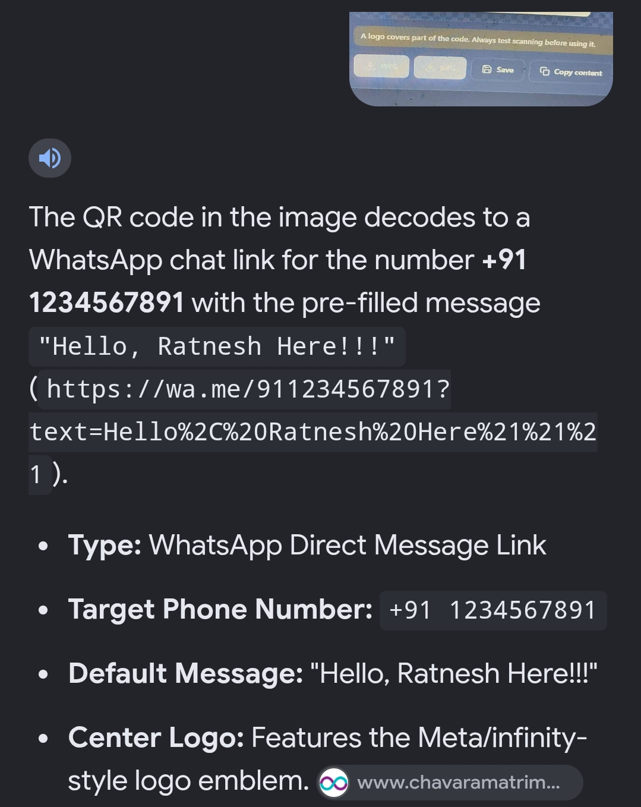</td>
    <td>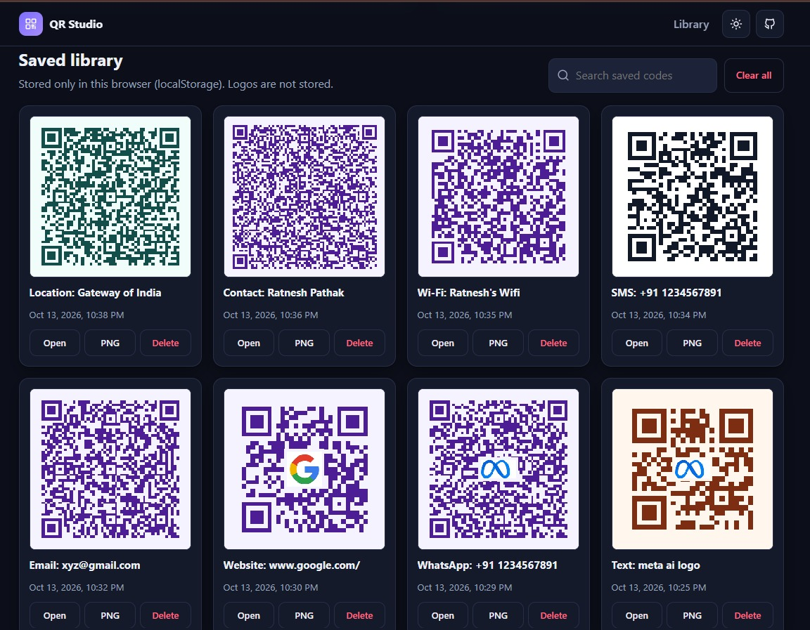</td>
  </tr>
</table>

## 📂 Screenshot Directory

All 12 interface screenshots are stored in [`docs/screenshots/ui/`](docs/screenshots/ui/).
```

## Project structure

```
QR-Code-Generator/
├── app.py                  # Flask app: routes, validation, PNG/SVG rendering
├── requirements.txt
├── README.md
├── LICENSE                 # MIT
├── .gitignore
├── templates/
│   └── index.html
├── static/
│   ├── css/style.css
│   └── js/app.js
├── tests/
│   └── test_app.py
└── docs/
    └── screenshots/
        └── README.md
```

## Setup on Windows (Git Bash)

Requires Python 3.9+ (check with `python --version`). Run these in Git Bash.

```bash
# 1. Enter the project folder (adjust the path to where you extracted/cloned it)
cd /c/Users/YourName/QR-Code-Generator

# 2. Create a virtual environment
python -m venv .venv

# 3. Activate it (Git Bash)
source .venv/Scripts/activate

# 4. Install dependencies
python -m pip install --upgrade pip
pip install -r requirements.txt

# 5. Start the app
python app.py
```

6. Open <http://127.0.0.1:5000> in your browser.
7. **Stop the app:** press `Ctrl + C` in the Git Bash window. Leave the environment with `deactivate`.

If `python` is not found, try `py` instead (`py -m venv .venv`). Next time, you only need steps 1, 3 and 5.

## Running the tests

With the virtual environment active:

```bash
python -m unittest discover -s tests -v
```

The suite covers the home page and static files, every content type, custom colors, sizes and error-correction levels, validation and malformed requests, PNG and SVG downloads (including a check that downloads match the preview), filename sanitising, logo uploads, and oversized requests.

## Usage

1. Choose a content type from the pill row.
2. Fill in the fields and press **Generate QR code**.
3. Adjust colors, size, error correction or add a logo. The preview updates automatically.
4. Use **PNG** or **SVG** to download, **Save** to add it to your library, or **Copy content** to copy the encoded text.
5. Reopen, download or delete saved codes from the **Saved library** section. Use the search box to filter.

Tip: always test-scan a code with your phone before printing it, especially with custom colors or a logo.

## Supported content and formats

| Type | Encoded as |
|---|---|
| Text | Raw text |
| Website | `http(s)://` URL (https is added if missing) |
| Email | `mailto:` with optional subject and body |
| Phone | `tel:` |
| SMS | `SMSTO:number:message` |
| Wi-Fi | `WIFI:T:...;S:...;P:...;H:...;;` (WPA, WEP or open) |
| vCard | vCard 3.0 contact |
| WhatsApp | `https://wa.me/<number>?text=...` |
| Location | Google Maps search URL (place text or coordinates) |

**Export formats:** PNG (raster, includes logo if added) and SVG (vector, generated from the QR module matrix; **does not include a logo**).

## Security and privacy notes

- QR codes are generated by the Flask app running on your machine. Content is sent only to that local server.
- Saved history and preferences live in your browser's `localStorage`. Clearing site data removes them. Wi-Fi passwords and other content you save are stored there **unencrypted**, so avoid saving secrets on shared computers.
- Logos are processed in memory and never written to disk. Only PNG/JPEG up to 1 MB and 4 megapixels are accepted, and files are verified with Pillow.
- All input is validated server-side; request bodies are capped at 2 MB; payloads are capped at 2000 characters; download filenames are sanitised; user content is never evaluated; unexpected errors return a generic message with no stack trace.
- The development server binds to `127.0.0.1` only. It is not intended for public hosting as is. If you deploy it, use a production WSGI server behind HTTPS.

## Known limitations

- Saved library entries do not store the logo, so reopened or downloaded saved codes are generated without it.
- The history is per browser and per device; there is no sync or export of the library.
- SVG export omits the logo overlay.
- Very long content may not fit a QR code at high error-correction levels and will return an error.
- Scan reliability depends on colors, logo size and print quality; the contrast warnings are guidance, not a guarantee.

## Future enhancements

- Include the logo in SVG exports
- Export/import of the saved library as JSON
- Rounded module and custom eye styles
- Batch generation from a CSV file
- Internationalization

## Developer

**Developed and designed by Ratnesh Pathak.**
GitHub: <https://github.com/RatneshPathak/QR-Code-Generator>

Released under the [MIT License](LICENSE).
